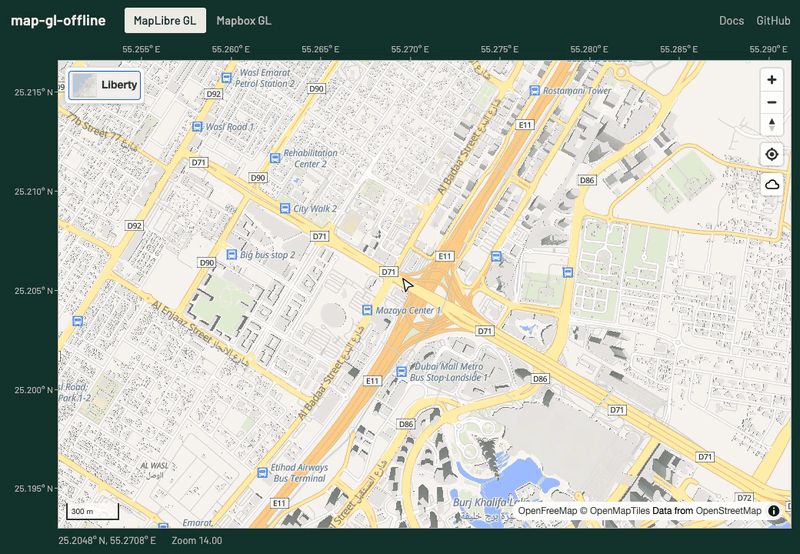

# map-gl-offline

[](https://badge.fury.io/js/map-gl-offline)
[](https://opensource.org/licenses/MIT)

Save a map area to the browser, then keep using it with no connection. Works with **MapLibre GL JS** and **Mapbox GL JS**, and stores everything in IndexedDB.

**[Documentation](https://map-gl-offline.netlify.app)** | **[Live demo](https://map-gl-offline-demo.netlify.app)** | **[Issues](https://github.com/muimsd/map-gl-offline/issues)**



- **Complete regions:** style, tiles, sprites, fonts and 3D models, including Mapbox Standard's terrain and buildings.
- **A control or an API:** add a ready-made panel where people draw an area and download it, or call `downloadRegion` yourself.
- **Accurate progress:** one percentage that only moves forward, with exact counts for each phase.
- **Storage management:** usage reports, expiry dates and automatic cleanup.
- **MBTiles:** export to and import from the format QGIS and tippecanoe read.
- **English and Arabic** in the control, including right-to-left layout.

## Install

```bash
npm install map-gl-offline maplibre-gl
# or
npm install map-gl-offline mapbox-gl
```

Load only one renderer per page: [MapLibre GL 6 breaks Mapbox GL](https://map-gl-offline.netlify.app/docs/guides/troubleshooting#a-mapbox-map-is-blank) when they share one.

## Quick start

### MapLibre GL JS

```ts
import * as maplibregl from 'maplibre-gl';
import { OfflineMapManager, OfflineManagerControl } from 'map-gl-offline';
import 'maplibre-gl/dist/maplibre-gl.css';
import 'map-gl-offline/style.css';

const styleUrl = 'https://tiles.openfreemap.org/styles/liberty';

const map = new maplibregl.Map({ container: 'map', style: styleUrl });

map.addControl(
  new OfflineManagerControl(new OfflineMapManager(), { styleUrl, mapLib: maplibregl }),
  'top-right'
);
```

With a bundler, MapLibre 6 also needs [its worker URL set](https://map-gl-offline.netlify.app/docs/getting-started#maplibre-gl-js).

### Mapbox GL JS

Mapbox GL serves stored tiles through a Service Worker, so copy its script to your `public/` folder first:

```bash
npx map-gl-offline init
```

```ts
import mapboxgl from 'mapbox-gl';
import { OfflineMapManager, OfflineManagerControl } from 'map-gl-offline';
import 'mapbox-gl/dist/mapbox-gl.css';
import 'map-gl-offline/style.css';

mapboxgl.accessToken = 'YOUR_MAPBOX_TOKEN';
const styleUrl = 'mapbox://styles/mapbox/standard';

const map = new mapboxgl.Map({ container: 'map', style: styleUrl });

map.addControl(
  new OfflineManagerControl(new OfflineMapManager(), {
    styleUrl,
    accessToken: mapboxgl.accessToken,
  }),
  'top-right'
);
```

### Download from code

```ts
import { OfflineMapManager } from 'map-gl-offline';

const offlineManager = new OfflineMapManager();

await offlineManager.downloadRegion(
  {
    id: 'downtown',
    name: 'Downtown',
    bounds: [
      [-74.02, 40.7], // south-west: [longitude, latitude]
      [-73.97, 40.75], // north-east
    ],
    minZoom: 10,
    maxZoom: 16,
    styleUrl: 'https://tiles.openfreemap.org/styles/liberty',
  },
  {
    onProgress: ({ overallPercentage, phase, completed, total }) => {
      console.log(`${Math.round(overallPercentage)}%: ${phase} ${completed}/${total}`);
    },
  }
);
```

Each zoom level has about four times the tiles of the one before, so keep high zooms to small areas. On Mapbox Standard, buildings start at zoom 15.

## Documentation

- [Getting started](https://map-gl-offline.netlify.app/docs/getting-started)
- [Downloading regions](https://map-gl-offline.netlify.app/docs/guides/downloading-regions)
- [Mapbox GL and Standard](https://map-gl-offline.netlify.app/docs/guides/mapbox)
- [The offline control](https://map-gl-offline.netlify.app/docs/guides/ui-control)
- [Storage and cleanup](https://map-gl-offline.netlify.app/docs/guides/storage)
- [MBTiles](https://map-gl-offline.netlify.app/docs/guides/mbtiles)
- [Troubleshooting](https://map-gl-offline.netlify.app/docs/guides/troubleshooting)
- [API reference](https://map-gl-offline.netlify.app/docs/api-reference)

## Contributing

```bash
git clone https://github.com/muimsd/map-gl-offline.git
cd map-gl-offline
npm install
npm run dev   # The demo
npm test      # Unit tests
```

See [Architecture](https://map-gl-offline.netlify.app/docs/architecture) for how it fits together, and the [changelog](CHANGELOG.md) for release notes. Issues and pull requests are welcome.

## License

MIT © [Muhammad Imran Siddique](https://github.com/muimsd)

If this project helps you, you can [buy me a coffee](https://www.buymeacoffee.com/muimsd).
